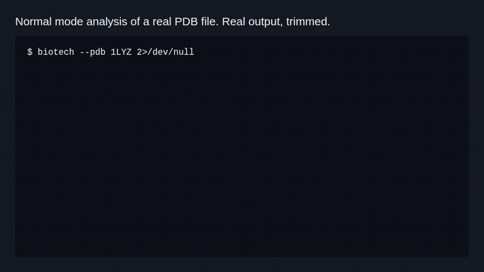

# Biotech Research Accelerator



[](https://github.com/jayhemnani9910/biotech-accelerator/actions/workflows/ci.yml) [](LICENSE)

Ask a protein question, get papers, flexibility analysis, active compounds and experiments to try.

```bash
pip install git+https://github.com/jayhemnani9910/biotech-accelerator.git
```

Python 3.10+. Use a venv: Debian and Ubuntu refuse `pip install` against system Python.

## Usage

```bash
biotech "What mutations stabilize lysozyme? Analyze PDB 1LYZ"
biotech "Find EGFR inhibitors"
biotech --pdb 1LYZ 4HHB
biotech --pdb 1LYZ --json
```

No API keys needed. There is no LLM in this: every step is plain code calling public databases, so the structure analysis gives the same numbers each run. PubMed results change as new papers appear. Logs go to stderr, so add `2>/dev/null` for just the report.

Real output of `biotech --pdb 1LYZ`, which takes about 5 seconds:

```
Structure Analysis: 1LYZ

Flexibility Profile:
 • Mean fluctuation: 0.145 Ų
 • Max fluctuation: 1.495 Ų

Flexible Regions (high mobility): residues 45-50, residues 67-73, residues 101-103
Rigid Core Regions (stable): residues 8-13, residues 23-41, residues 52-59
Hinge Residues (potential motion points): 46, 47, 48, 49, 50
Vibrational Entropy (relative score): -0.19
```

The site at [jayhemnani9910.github.io/biotech-accelerator](https://jayhemnani9910.github.io/biotech-accelerator/) is a walkthrough of the pipeline. Its terminal lines are hand-written examples and nothing runs in your browser. Install the package to run real queries.

## How it works

The query goes through a LangGraph pipeline:

```
parse_query       pull out PDB IDs, protein names, and whether it's a drug question
resolve_proteins  protein name -> UniProt ID -> PDB structures
literature        PubMed search, dedupe by PMID, score relevance
structure         download the PDB file, run normal mode analysis with ProDy
drug              ChEMBL search, only for drug questions
synthesis         map mutations onto flexible and rigid regions, suggest experiments
```

| Source | Used for | Key |
|--------|----------|-----|
| PubMed | Papers and mutation mentions (V600E, Ala42Gly, p.V600E) | Optional |
| UniProt | Protein names to IDs and structures | None |
| RCSB PDB | Structure files | None |
| ChEMBL | Compound activity and approved drugs (max phase 4) | None |
| ProDy | ANM normal modes, run locally on your machine | None |

- Compounds are ranked on a common nM scale and graded: under 10 nM, 10-100 nM, 100-1000 nM.
- API responses are cached for 24 hours. PDB files are cached in `~/.biotech-accelerator/pdb_cache`.
- PubMed requests are spaced 400 ms apart. Failed requests retry with exponential backoff.

## Known rough edges

These show up in real runs. The results are a starting point, so check them before you plan lab work.

- The mutation regex can match things that aren't mutations. T4L, short for T4 lysozyme, gets reported as a mutation.
- The whole question goes to PubMed as typed, so "Find EGFR inhibitors" also returns the FIND-CKD trial.
- IC50 values print to one decimal place, so very small values show as `0.0 nM`.

## Configuration

All optional. See `.env.example`.

| Variable | Default | Purpose |
|----------|---------|---------|
| `PUBMED_EMAIL` | `biotech-accelerator@example.com` | Contact email sent to NCBI with each request |
| `PUBMED_API_KEY` | none | NCBI key for higher PubMed rate limits |
| `PDB_CACHE_DIR` | `~/.biotech-accelerator/pdb_cache` | Where structure files are cached |

## Docker

```bash
docker build -t biotech-accelerator .
docker run --rm biotech-accelerator --pdb 1LYZ
```

## Python

```python
import asyncio
from biotech_accelerator.graph.biotech_graph import run_research

result = asyncio.run(run_research("What mutations stabilize lysozyme?"))
print(result["final_report"])
```

Adapter methods are listed in [docs/api.md](docs/api.md). `example_walkthrough.py` runs each layer on its own, then the full pipeline.

## MCP server

`biotech-mcp` exposes the pipeline as 14 tools to Claude Code or any other MCP client. Clone the repo, install [uv](https://github.com/astral-sh/uv), and start your client from the repo root. It picks up `.mcp.json`, which launches the server with `uv run`. For a plain venv, point `command` in `.mcp.json` at `./.venv/bin/biotech-mcp`.

| Group | Tools |
|-------|-------|
| Literature | `search_literature`, `search_literature_by_protein` |
| Structures | `resolve_protein`, `fetch_structure`, `run_nma`, `search_structures` |
| Compounds | `search_compounds_by_target`, `get_compound`, `get_approved_drugs_for_target` |
| Analysis | `extract_mutations`, `cross_reference_mutations`, `run_research` |
| Cache | `cache_stats`, `clear_cache` |

## Project layout

```
biotech_accelerator/
  adapters/       PubMed, RCSB PDB, UniProt, ChEMBL clients
  agents/nodes/   literature, structure, drug, synthesis and experiment steps
  analysis/       ProDy normal mode wrapper
  domain/         protein and compound models
  graph/          the LangGraph pipeline
  ports/          data models for the adapters
  utils/          cache and JSON serialization
  main.py         biotech CLI
  mcp_server.py   biotech-mcp server
tests/            195 unit tests, 6 live API tests
```

## Contributing

See [CONTRIBUTING.md](CONTRIBUTING.md).

## License

[MIT](LICENSE)
